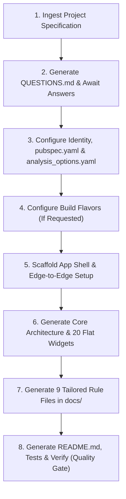

# Flutter Project Starter Skill

An autonomous, end-to-end scaffolding skill that transforms any greenfield Flutter repository into a production-ready, clean-architecture project with complete infrastructure, core services, flat widgets, tailored documentation, and unit tests.

**Zero External Dependencies:** This skill and its `references/` directory are 100% self-contained. The AI agent must never instruct the user to copy files or inspect external repositories.

---

## Core Tenets

1. **Self-Contained & Modular:** All code blueprints, widget implementations, configuration templates, and documentation rules are embedded directly in the `references/` directory.
2. **Questionnaire First (`QUESTIONS.md`):** Never assume architectural choices. Upon receiving a project specification, the agent creates `QUESTIONS.md` in the project root to clarify all key decisions before generating code.
3. **Feature-First Clean Architecture:**
   - Strict layer isolation: `Data`, `Domain`, and `Presentation`.
   - Shared logic belongs in `lib/core/`.
   - Shared UI widgets reside **flat** in `lib/core/widgets/` with no subdirectories.
4. **Storage Abstraction:**
   - `LocalStorage` and `SecureStorage` interfaces hide underlying package implementations.
   - `Drift (SQLite)` for relational, offline-first data.
   - `SharedPreferences` for general preferences and flags.
   - `FlutterSecureStorage` for encrypted PINs and authentication tokens.
5. **Tailored Documentation:** The agent **must always generate the 9 standard architecture and UI rule files** in `docs/` customized specifically to the project's selected options.

---

## Reference Blueprint Index

| Reference Module | Purpose & Scope |
|---|---|
| 📋 **[`references/questionnaire_template.md`](references/questionnaire_template.md)** | Full customization questionnaire template written to `QUESTIONS.md`. |
| 🚀 **[`references/flavors_setup.md`](references/flavors_setup.md)** | Multi-environment build flavors (`development`, `staging`, `production`) for Android & iOS. |
| 🎨 **[`references/theme_and_locale_engine.md`](references/theme_and_locale_engine.md)** | Single vs Dual Themes (`ThemeExtension`), ARB Localization, and Edge-to-Edge System UI. |
| 🗄️ **[`references/local_storage_abstraction.md`](references/local_storage_abstraction.md)** | `LocalStorage` and `SecureStorage` interfaces, hidden implementations, and centralized keys. |
| 🌐 **[`references/network_and_rest_api.md`](references/network_and_rest_api.md)** | REST API architecture: `DioFactory`, Interceptors, `AppConfig.useFakeApi`, and `safeApiCall`. |
| 🧩 **[`references/core_widgets.md`](references/core_widgets.md)** | Production-ready implementations for all 20 flat widgets in `lib/core/widgets/`. |
| 🏛️ **[`references/core_architecture.md`](references/core_architecture.md)** | Entry point, responsive `AppSize`, `AppConstants`, sealed `Failure`/`Result`, and DI wiring. |
| 📜 **[`references/docs_generator.md`](references/docs_generator.md)** | Specifications for generating the 9 tailored markdown rule files in `docs/`. |
| ⚙️ **[`references/config_templates.md`](references/config_templates.md)** | Standard `pubspec.yaml`, strict `analysis_options.yaml`, and high-impact `README.md`. |

---

## Execution Lifecycle

---

### Step 1: Ingest Specification & Generate Questionnaire
1. Read the provided specification file (typically `docs/PROJECT_SPECIFICATION.md` or user brief).
2. Generate `QUESTIONS.md` in the project root based on [`references/questionnaire_template.md`](references/questionnaire_template.md).
3. Present the questions to the user and wait for explicit answers regarding:
   - Build flavors (Single vs Dev/Staging/Prod).
   - State management: `Riverpod` (default) vs `Bloc/Cubit + GetIt`.
   - Backend: `REST API (Dio)` vs `Firebase` vs `Supabase` vs `Local Only`.
   - Authentication: No auth (PIN only) vs Full auth flow.
   - Database: `Drift (SQLite)` vs lightweight storage only.
   - Theme: Single theme vs Light/Dark dual themes with brand color codes.
   - Language: Arabic only (Fusha) vs Multi-language (ARB).
   - Display name and application ID.

---

### Step 2: Configure Environment & Dependencies
1. **Application Identity:**
   - Update `applicationId` and `namespace` in `android/app/build.gradle.kts`.
   - Update `android:label` in `AndroidManifest.xml`.
2. **`pubspec.yaml`:**
   - Apply the template from [`references/config_templates.md`](references/config_templates.md) §1 using `# ----------` section separators.
   - Include only the packages matching user choices (exclude unused packages).
   - Configure `flutter_launcher_icons` and `flutter_native_splash`.
3. **`analysis_options.yaml`:**
   - Apply the strict linter rules from [`references/config_templates.md`](references/config_templates.md) §2.
4. **Build Flavors (If Selected):**
   - Apply Android and iOS flavor configurations from [`references/flavors_setup.md`](references/flavors_setup.md).

---

### Step 3: Scaffold Application Shell & Edge-to-Edge
1. **`lib/main.dart`:**
   - Initialize platform services via `AppInitializer.initialize()`.
   - Wrap the root widget in `ProviderScope` (or Bloc provider) with overrides for synchronous storage.
2. **`lib/app/app.dart`:**
   - Build the root `MaterialApp.router` with `GoRouter`.
   - Add `AppScrollBehavior` (`lib/core/theme/app_scroll_behavior.dart`) and set `scrollBehavior: const AppScrollBehavior()` on `MaterialApp.router` so Android's overscroll stretch/glow is disabled globally. This is a platform indicator, not a `CustomScrollView` bug; see [`references/core_architecture.md`](references/core_architecture.md) §3.
   - In `builder(context, child)`:
     - Invoke `AppSize.init(context)`.
     - Apply `context.preventTextScaling(child)`.
     - Wrap in `GestureDetector(behavior: HitTestBehavior.opaque, onTap: context.unfocus, ...)`.
     - Apply `AnnotatedRegion<SystemUiOverlayStyle>` for transparent edge-to-edge system navigation as documented in [`references/theme_and_locale_engine.md`](references/theme_and_locale_engine.md) §1.

---

### Step 4: Generate Core Infrastructure (`lib/core/`)
Generate all required files based on user choices:
1. **Storage Abstraction:** Implement `LocalStorage` and `SecureStorage` from [`references/local_storage_abstraction.md`](references/local_storage_abstraction.md).
2. **Network Layer (If REST API selected):** Implement `DioFactory`, interceptors, and `safeApiCall` from [`references/network_and_rest_api.md`](references/network_and_rest_api.md).
3. **Theme & Localization:** Implement single or dual themes and locale engines from [`references/theme_and_locale_engine.md`](references/theme_and_locale_engine.md).
4. **Architecture Baseline:** Generate responsive metrics `AppSize`, `AppConstants`, `AppStrings`, sealed `Failure`, and sealed `Result<T>` from [`references/core_architecture.md`](references/core_architecture.md).
5. **20 Core Flat Widgets:** Generate all shared widgets directly inside `lib/core/widgets/` from [`references/core_widgets.md`](references/core_widgets.md).

---

### Step 5: Generate Tailored Documentation (`docs/`)
The agent **must generate all 9 custom rule files** inside `docs/` according to [`references/docs_generator.md`](references/docs_generator.md):
1. `docs/architecture/01_naming.md`
2. `docs/architecture/02_logging_and_errors.md`
3. `docs/architecture/03_code_conventions.md`
4. `docs/design_system/01_theme.md`
5. `docs/design_system/02_tokens.md`
6. `docs/ui/01_layout.md`
7. `docs/ui/02_widgets.md`
8. `docs/ui/03_text.md`
9. `docs/ui/04_tap.md`

Update `docs/PROJECT_SPECIFICATION.md` to reflect finalized decisions.

---

### Step 6: Root Deliverables, Testing & Verification (Quality Gate)
1. **Generate `README.md`:** Apply the branded template from [`references/config_templates.md`](references/config_templates.md) §3 with typing logo, Shields badges, and collapsible feature cards.
2. **Unit & Widget Tests:**
   - Test validators in `test/core/utils/`.
   - Test `Result<T>` sealed behavior in `test/core/error/`.
   - Test storage read/write in `test/core/services/local_storage/`.
   - Test app shell rendering in `test/widget_test.dart`.
3. **Automated Verification:**
   - Run `dart format .` (must format cleanly).
   - Run `flutter analyze` (must pass with 0 errors and 0 warnings).
   - Run `flutter test` (all tests must pass).
4. **Implementation Report:** Write `IMPLEMENTATION_REPORT.md` in the project root summarizing all created files, architectural patterns, and guidance for implementing the first feature.
