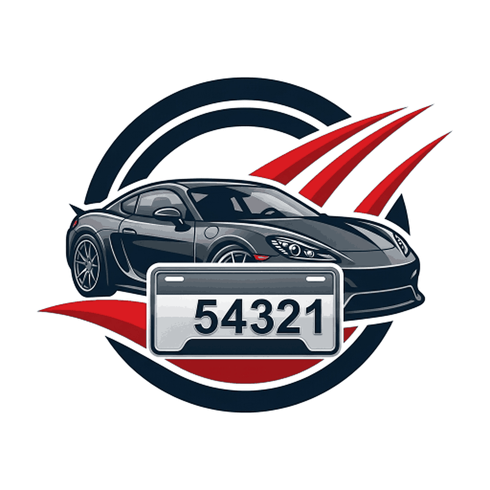
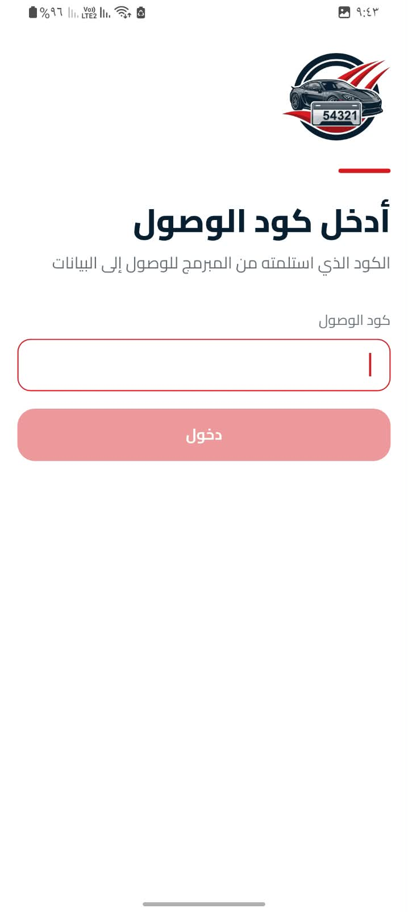
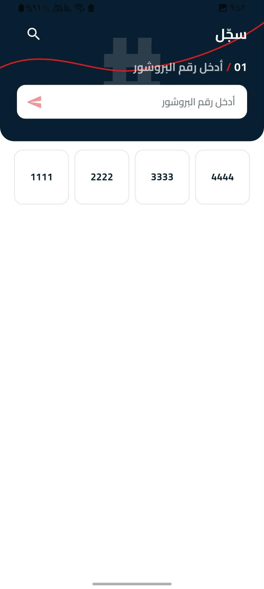
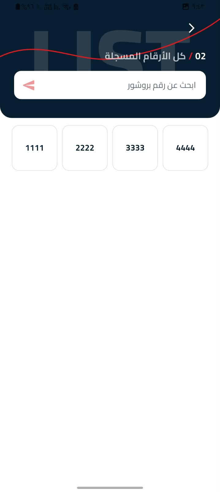
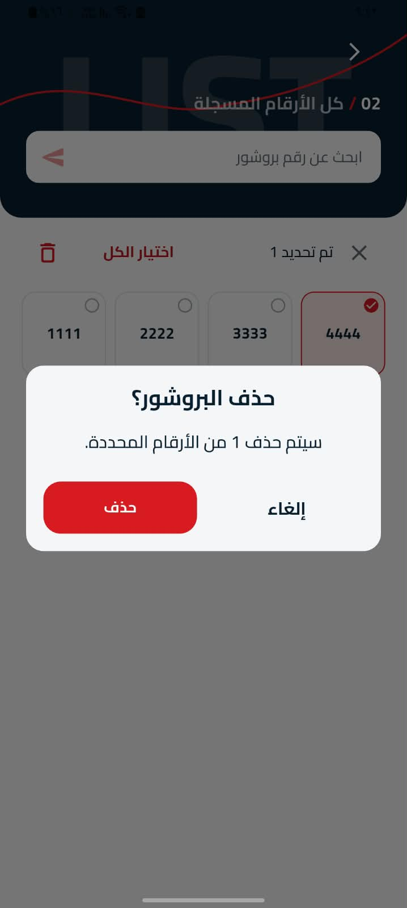

<!-- Badges at Top -->

  
  
  
  

<!-- Typing Logo -->

<!-- Links Section -->

  
  

  

<!-- TODO: replace the placeholder icon below with readme_assets/all_views.jpg when available. -->
<!-- TODO: replace the table placeholders with readme_assets/car_plate_gif.gif and readme_assets/all_views.jpg when available. -->

 
 

| Access Control | Home | Search | Delete |
|:---:|:---:|:---:|:---:|
|  |  |  |  |

  

<b>📋 Brochure Numbers</b>

 

- **Add &amp; Save**: Record car brochure numbers from 1 to 4 digits.
- **Leading Zeros**: Numbers are stored as `String`, so `007` stays `007`.
- **Search &amp; Count**: Search any number and see the total registered count.
- **Delete**: Delete a single number after a confirmation dialog.

<b>🔒 App Lock</b>

 

- **Device-Local PIN**: Lock the app with the device's local PIN/pattern authentication.
- **Biometrics**: Fingerprint support when available and enabled on the device.
- **Auth Guard**: Opt-in `runWithLocalAuth` guard wraps sensitive actions behind authentication.
- **Result Handling**: Covers success, cancelled, unavailable, not enrolled, locked out, busy, and error states.
- **Availability Check**: Verifies device authentication support before prompting.

  

- **Framework**: `Flutter`
- **Language**: `Dart`
- **State Management**: `Riverpod`
- **Cloud Database**: `Firebase Firestore`
- **Architecture**: `Feature-First Clean Architecture`
- **Testing**: `Unit, Widget, Integration Tests`

Made with ❤️ by Korya
 
<b>© 2026 Car Register App</b>

