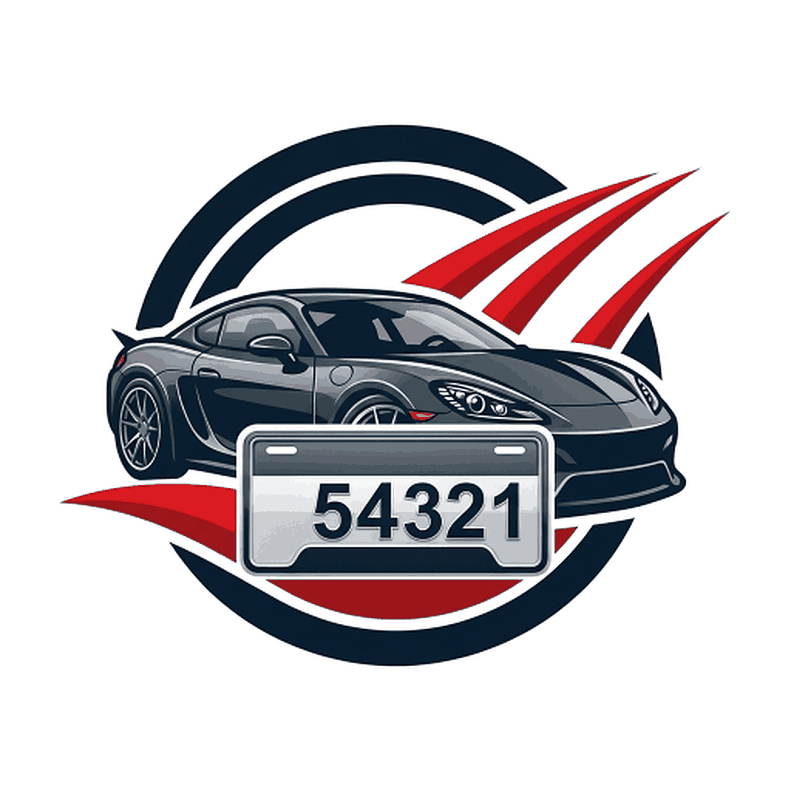

<!-- Badges at Top -->

  
  
  
  

<!-- Typing Logo -->

<!-- Links Section -->

  
  

  

<!-- TODO: replace the placeholder icon below with readme_assets/all_views.jpg when available. -->
<!-- TODO: replace the table placeholders with readme_assets/car_plate_gif.gif and readme_assets/all_views.jpg when available. -->

 
 

| | |
|:---:|:---:|
|  |  |
| **Live Demo** | **All Views** |

  

<b>📋 Brochure Numbers</b>

 

- **Add &amp; Save**: Record car brochure numbers from 1 to 4 digits.
- **Leading Zeros**: Numbers are stored as `String`, so `007` stays `007`.
- **Search &amp; Count**: Search any number and see the total registered count.
- **Delete with Undo**: Delete a single number with confirmation and an Undo option.
- **Delete All**: Clear every number with a clear confirmation dialog.

<b>🔗 Shared Data</b>

 

- **Multi-Device Access**: The same data is available on multiple devices.
- **Shared Access PIN**: Enter the PIN once per device — never again for daily use.
- **Sync Changes**: Additions and deletions sync across devices.
- **Device Revocation**: Revoke a lost device or change the PIN when needed.
- **No Traditional Login**: No email/password accounts, and no in-app PIN creation screen.

<b>📴 Offline &amp; Synchronization</b>

 

- **Offline First**: Work without internet using a local database.
- **Auto Sync**: Pending changes sync automatically when the connection returns.
- **No Duplicates**: Retries never create duplicate records.
- **No Resurrection**: Deleted records never come back after sync.
- **Conflict Handling**: Safe behavior when several devices edit at the same time.

<b>🔒 App Lock</b>

 

- **Local PIN**: Lock the app with a device-local PIN.
- **Biometrics**: Fingerprint support when available and enabled.
- **Separate From Sharing**: The app lock PIN is independent of the Shared Access PIN.

<b>📄 CSV Import &amp; Export</b>

 

- **Import &amp; Export**: Move numbers in and out as CSV.
- **Leading Zeros Preserved**: `007` stays `007` in CSV.
- **Validation**: Imported data is validated before it is saved.

  

- **Framework**: `Flutter`
- **Language**: `Dart`
- **State Management**: `Riverpod`
- **Local Database**: `SQLite / Drift`
- **Cloud Database**: `Firebase Firestore`
- **Architecture**: `Feature-First Clean Architecture`
- **Testing**: `Unit, Widget, Integration Tests`
- **CI/CD**: `GitHub Actions`
- **Delivery**: `Signed Android APK`

Made with ❤️ by Korya
 
<b>© 2026 Car Register App</b>

